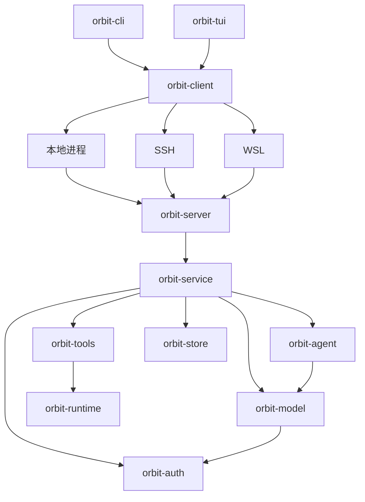

# Orbit

Orbit 是用 Rust 编写的终端编码 Agent。它提供交互式 TUI 和单次命令行任务，支持多供应商模型、文件工具、命令执行、可选沙箱、持久化会话、后台命令与探索、审查、开发子代理。

## 启动

使用 stable Rust 工具链构建，源码构建还需要 `musl-tools`（含 `musl-gcc`）、`binutils` 和同架构 Rust musl target（x86-64：`rustup target add x86_64-unknown-linux-musl`；AArch64：`rustup target add aarch64-unknown-linux-musl`）；依赖版本由 `Cargo.lock` 固定。命令默认使用目标用户的 shell 与真实开发环境；在 `[command]` 中设置 `sandbox = true` 可启用 Linux Bubblewrap 隔离，此时需要 `bwrap`、`prlimit` 和可用的用户命名空间。审批模式独立于沙箱设置。文件工具使用 Unix 文件描述符接口；其他系统尚未提供完整的等价执行后端。

```sh
cargo run --release -p orbit-tui
./target/release/orbit --help
./target/release/orbit
```

普通 `cargo build` 会自动构建并内置同架构的静态远端服务；首次构建会多花一些时间，后续复用独立的构建缓存。每个前端可执行文件内置服务资源，分发、安装或移动时无需伴随服务文件，用户无需安装 musl 工具链、准备额外服务文件或升级服务器 glibc。`scripts/build-bundle.sh` 将两个前端复制到 `target/bundle/`。

在 TUI 内用 `/ssh HOST [PATH]`、`/wsl DISTRO [PATH]` 打开远端标签，本地与多个远端会话可同时运行；`/new` 在当前环境新建会话，`/local` 新建本地标签。界面在本机渲染，Agent 与工具在各自环境运行。也保留实验性的命令行连接入口：

```sh
orbit-cli connect --workspace /path/to/project
orbit-cli connect --ssh my-host --workspace /home/me/project
orbit-cli connect --wsl Ubuntu --workspace /home/me/project
```

`/ssh`、`/wsl` 可打开连接弹窗，提供别名补全、认证提示、连接日志与远端目录选择；指定主机和目录则直接连接。SSH 沿用系统 OpenSSH 配置；SSH/WSL 首次连接自动上传匹配架构的 Linux 服务二进制。远端会话默认沿用本地配置和所引用的认证，无需在目标项目创建 `config.toml`；目标仍需工具执行依赖。本仓库目前仍是 Linux 客户端，WSL 适配器需要调用环境能运行 `wsl.exe`，不代表已支持 Windows 原生构建。断开连接不会取消任务，可用相同参数加 `--resume <ID>` 接回。支持范围、配置路径和恢复行为见 [工作区连接说明](crates/orbit-client/README.md#工作区服务)。

用 TUI 的 `/connect` 配置连接，或参考 [config.example.toml](config.example.toml) 编写 `config.toml`。可用 `--config <路径>` 指定配置文件，API Key 也可通过 `orbit-cli auth set-key` 保存，再用配置中的 `credential` 引用。示例中的模型 ID 和能力需要与实际服务一致。

API 模型的可用列表由服务接口发现；公共模型规格补齐缺失能力，缓存与离线快照保证更新失败后仍可使用。用户配置和服务返回的能力优先，详见 [模型目录说明](crates/orbit-config/README.md#模型目录)。

网页读取、搜索与网络图片自动沿用启动环境中的 `HTTP_PROXY`、`HTTPS_PROXY`、`ALL_PROXY`（也支持小写）和 `NO_PROXY`，通常无需为 Orbit 再配置代理。可选的 `[web].proxy` 用于显式覆盖环境路由；默认仅允许公网目标；`allowed_origins` 可授权指定的内网 HTTP(S) 来源，重定向的每一跳均按策略校验。

```sh
orbit-cli chat "审查当前项目的代码并说明发现的问题"
orbit --resume <SESSION_ID>
orbit-cli sessions list
orbit-cli sessions diagnostics <SESSION_ID>
orbit-cli model-metadata crates/orbit-config/src/models/model_metadata.json
```

TUI 图标需要 Nerd Font 字体。图片按终端能力选择 Kitty、Sixel 或 iTerm2 协议；不支持像素图形时图片使用字符预览，公式保留 TeX。Markdown、HTML、代码、图片和 RaTeX 数学公式的支持范围见 [TUI 文档](crates/orbit-tui/README.md)。

## 工作区结构

| Crate | 职责 | 文档 |
| --- | --- | --- |
| `orbit-cli` | 命令行参数、入口分发、输出与信号 | [README](crates/orbit-cli/README.md) |
| `orbit-tui` | 终端绘制、排版、键鼠交互、标签与弹窗 | [README](crates/orbit-tui/README.md) |
| `orbit-client` | 本地、SSH、WSL 连接、部署和事件订阅 | [README](crates/orbit-client/README.md) |
| `orbit-protocol` | 请求、事件封装、能力与分帧 | [README](crates/orbit-protocol/README.md) |
| `orbit-config` | 共享配置、模型目录与连接编辑 | [README](crates/orbit-config/README.md) |
| `orbit-service` | 会话、工具装配、任务与工作区服务 | [README](crates/orbit-service/README.md) |
| `orbit-server` | 无界面服务可执行入口 | [README](crates/orbit-server/README.md) |
| `orbit-agent` | 模型/工具执行循环、消息边界、后台等待、上下文整理 | [README](crates/orbit-agent/README.md) |
| `orbit-model` | 通用消息类型、供应商协议、模型目录与思考参数适配 | [README](crates/orbit-model/README.md) |
| `orbit-auth` | 凭据存储、OAuth 回调、令牌刷新与服务地址绑定 | [README](crates/orbit-auth/README.md) |
| `orbit-runtime` | 工作区文件访问、执行策略、进程资源与 Linux 隔离 | [README](crates/orbit-runtime/README.md) |
| `orbit-tools` | 文件、命令、网页、文档、交付与 MCP 工具 | [README](crates/orbit-tools/README.md) |
| `orbit-store` | SQLite 会话、规范日志、执行检查点和子任务持久化 | [README](crates/orbit-store/README.md) |

CLI 和 TUI 通过 `orbit-client` 连接目标端的 `orbit-server`，本地、SSH、WSL 使用同一会话协议。应用服务组装领域库，Agent 依赖模型与工具接口，工具通过 runtime 授权和执行，store 保存会话与运行证据。



界面持有布局、选区和显示状态，应用层持有运行资源和执行任务。依赖向领域库流动，领域库独立于前端。`scripts/check-architecture.py` 检查包依赖与前端执行边界。

## 任务与会话

- 后台命令立即返回任务 ID，完成后自动回传结果；Agent 可以继续其他工作，空闲时通过事件等待。命令进程不跨程序重启恢复。
- 子代理提供独立的探索、审查和开发角色；开发角色默认使用 Git worktree，并继承父审批策略，默认并行上限 8，支持补充消息和原会话续跑。默认不限轮数；超时配置用于提醒父代理查看进度，不直接终止子代理。
- `/btw` 在弹窗中独立回答旁路问题，不调用工具、不改变主会话上下文。
- Agent 可通过 `ask_user` 在弹窗中发起多题问答，支持选择、自定义填写和填空；`/answers` 查看问答记录。
- SQLite 保存会话、消息、任务结果与检查点；多个终端可同步打开同一会话，由共享服务串行处理操作并持有写入锁。数据库、附件和 scratch 位于用户数据目录，具体路径见 [存储文档](crates/orbit-store/README.md)。

### Plan / Build

- `/plan` 进入只读规划，Agent 也可用 `enter_plan` 自主进入；`/build` 返回执行模式。Shift+Tab 切换工作模式。运行中需先停止或等待任务完成。
- Plan 可读取文件、搜索、调用探索/审查子代理及 `ask_user`。服务端会拦截文件修改、任意 shell 命令、MCP 执行、开发子代理和权限扩张；子代理共享这层限制。测试、构建和安装属于 Build。
- Agent 用 `update_plan` 保存正文、步骤及相关文件路径，再用 `submit_plan` 等待确认。点击工具记录、底部“计划待确认”或执行 `/plan view` 打开审阅弹窗；可阅读方案、提交修改意见或明确选择“开始执行”。收起弹窗不会批准计划，其他终端的更新也不会抢焦点。
- 反馈提交后自动关闭弹窗并继续只读修改；批准后进入 Build，实施步骤加入 `/tasks`。Enter 只激活当前焦点按钮，默认焦点不会批准；反馈输入区 Enter 换行，Ctrl+Enter 提交意见。
- 计划及每次状态变化保存在目标会话的 SQLite 数据库，含版本、工作目录、用户意见和关联任务。服务重启后可以继续审阅，不会自动执行。多终端批准按版本校验并去重；批准时核对 Agent 声明的相关文件指纹（最多 32 个，单文件 8 MiB、总计 64 MiB），未列出的文件不在此检查范围内。
- 工作模式与审批设置独立。`/permissions ask|auto|yolo` 保留现有授权习惯；批准计划不会跳过工具审批。单纯 `/build` 不会批准或自动执行未批准的计划。

权限模式、命令网络策略、受保护文件、外部授权和 MCP 宿主进程的边界见 [工具文档](crates/orbit-tools/README.md) 与 [运行时文档](crates/orbit-runtime/README.md)。

## 开发与验证

```sh
python3 scripts/check-architecture.py
cargo fmt --all --check
cargo clippy --workspace --all-targets -- -D warnings
cargo test --workspace
```

依赖已缓存时可为 Clippy 和测试增加 `--offline`。部分测试启动本地回环 HTTP 服务，需要允许本地监听，不需要真实供应商账号。CI 配置见 [.github/workflows/ci.yml](.github/workflows/ci.yml)。

标记为 ignored 的真实沙箱与工具链测试不会被普通测试命令执行。沙箱测试需要 Linux 用户命名空间；编码循环测试还需要 Python、Node，以及 `ORBIT_TEST_RUST_TOOLCHAIN` 指向可挂载的 Rust 工具链：

```sh
cargo test -p orbit-tools --test sandbox -- --ignored
cargo test -p orbit-tools --test coding_loop -- --ignored
```

代码维护约定：

- 按职责归属共享类型、策略和接口，调用方复用所属模块的实现；局部实现保持私有，不为测试扩大公共 API。
- 常量按领域归类，用 `SCREAMING_SNAKE_CASE` 表达用途，数值名称注明字节、行数等单位，时间使用 `Duration`。参数默认值、Schema 上限与实际校验使用同一来源；数值相同但语义不同的策略保持独立。
- 函数内按解析与校验、资源准备、执行与等待、回执整理等逻辑阶段留空行，避免代码堆叠，也不逐行插入空行。
- 导入按标准库、外部依赖、当前 crate 分组。注释只解释必要的接口约束、协议差异、安全前提和不明显的行为；不复述函数名、字段名或测试步骤。CLI 的帮助注释同时作为用户文案维护。
- 按职责拆分长文件，原入口保留明确的调用接口；较大的测试模块放入对应目录的 `tests.rs`。相似实现先核对语义再复用，保留供应商协议、权限校验和不同分页游标的边界。
- 修改后先运行相关回归，再执行工作区检查，并核对公共接口、回执结构和最终差异。未执行的 ignored 测试不计为已验证。
- 项目文档统一维护在根目录和各 crate 的 README 中；新增或移动模块时同步更新相关 README，并检查本地链接。

## 核心流程审计（2026-10-08）

审计基线：`07e92cd`。范围为恢复与多端同步、输入与附件、工具与审批、问答弹窗、Plan/Build，以及对应测试与 CI。本节记录源码审计结论和待实施方案，不代表已经完成修复，也不是全仓缺陷穷举。本轮未构建、未运行 Rust 测试、未改业务代码或用户数据；运行时体验与真实终端渲染仍需后续验收。

结论：保留现有 client/service/agent/store 分层和每会话 actor。当前最需要处理的是测试仍执行旧实现、弹窗交互生命周期分散、媒体回执与最终请求之间缺少统一核对。不能用测试数量或全绿替代用户流程验证，也不能把所有历史兼容测试一起删除。

### 五条流程的行为约定

以下约定作为整改验收目标；其中“模型变化保留图片草稿”和统一媒体交付回执属于本次建议，当前实现尚不满足。

| 流程 | 状态归属与验收目标 |
| --- | --- |
| 恢复与多端同步 | 服务持有会话与运行状态；窗口持有标签和本地草稿。同一会话可被多个终端订阅，断连不取消任务；重试不重复执行。恢复成功后才移除可替换的空首页，失败保留重试入口，有草稿的标签不能被误删。 |
| 输入与附件 | 尚未发送的文字、附件归当前终端；服务更新和发送回执不能覆盖后来输入的草稿。新消息前后空白规范化一次，发送与显示一致；文件路径不误判成命令。模型不支持图片时保留草稿并明确阻止不兼容发送，不隐式删除附件。 |
| 工具与审批 | 审批阻止副作用执行，输入区仍能编辑；编辑、滚动、选中文本不能意外批准。批准、拒绝、取消、断线重接都由服务确认，重复回执不重复执行。 |
| 问答 | hover、键盘焦点、答案选择是不同状态；鼠标命中当前绘制区域，换题后的 release 不激活新按钮。单选点击前进，多选保留当前题，自定义答案原行编辑；提交收到成功回执后关闭，失败保留答案。历史记录只读，点击记录不能冻结画面。 |
| Plan/Build | 服务在实际执行工具时强制只读，子代理继承约束；收起、查看、反馈不等于批准。批准校验版本并且只生效一次；批准计划不取消工具审批；切换 Build 不自动批准计划。 |

### 发现与整改优先级

优先级表示整改顺序，不表示已发生安全事故。下面分别标明已确认事实、由调用链推导的风险和需要改变的产品约定。

**A1 · 优先处理：测试专用旧标签实现。**

- 证据：[tabs.rs](crates/orbit-tui/src/tui/tabs.rs) 通过 `cfg(test)` 引入并导出 [tabs_legacy.rs](crates/orbit-tui/src/tui/tabs_legacy.rs)，后者包含完整的 `ParkedTab`、旧 `Tabs`、窗口持久化及四个测试；[standalone.rs](crates/orbit-tui/src/tui/workspace_client/standalone.rs) 正式入口使用 `tabs::live::Tabs`。[tui/tests.rs](crates/orbit-tui/src/tui/tests.rs) 的失败恢复测试也调用旧 `tabs::Tabs`。
- 影响：这部分测试覆盖的是测试专用执行路径，不能作为新版标签行为的证据。并非所有标签测试都失效，[workspace_client/tests.rs](crates/orbit-tui/src/tui/workspace_client/tests.rs) 已有直接覆盖 live Tabs 的恢复、草稿和复用测试。
- 处理：逐条提取仍有效的行为，映射到 live Tabs/服务/窗口注册表；补齐缺项后删除旧实现及重复测试。不要把旧实现换个名字继续保留。
- 验收：正式入口和行为测试引用同一标签实现；恢复失败、部分成功、已有会话复用、草稿保护和断连重试均有当前路径验证。

**A2 · 优先处理：不可达审批弹窗仍被测试。**

- 证据：[approval.rs](crates/orbit-tui/src/tui/approval.rs) 的 `file_modal()` 恒为 `false`，但仍保留 `draw_file_modal()` 和 [render.rs](crates/orbit-tui/src/tui/render.rs) 的布局分支。[approval/render_tests.rs](crates/orbit-tui/src/tui/approval/render_tests.rs) 的 `preview_wheels_scroll_preview_and_outside_wheels_scroll_chat` 三次直接绘制旧弹窗，还断言其行位置和缓存地址。
- 影响：测试绕过了用户实际入口，保留了已退出产品的布局约束。这是可以确认的过时测试，不只是命名陈旧。
- 处理：删除不可达入口及专属布局，把“预览滚动不干扰正文/草稿”的断言迁移到当前内联审批。差异渲染、控制字符转义等仍被使用的能力保留独立测试。
- 验收：审批期间可以输入、选择和滚动；只有明确审批操作触发回执；生产代码没有恒假分支或仅为旧测试保留的渲染入口。

**A3 · 优先处理：PDF 附图回执与最终模型请求的范围不同。**

- 证据：[read_document/vision.rs](crates/orbit-tools/src/read_document/vision.rs) 每次工具调用最多附四页，回执记录 `attached_pages`；[agent.rs](crates/orbit-agent/src/agent.rs) 的 `model_messages()` 对整次请求只保留最新四张图片。`append_loaded_attachments()` 在该投影前生成“已载入此请求”的文字。
- 影响：由调用链可推导，同一轮多次读取图片、累计超过四张时，工具成功附上的部分图片仍会在请求投影时被移除。投影会补充 omitted 提示，并非完全静默，但工具回执和“已载入”的陈述没有同步更新。现有单次附图测试与四图上限测试分别通过，也不能证明组合场景准确。本轮未运行该组合复现。
- 处理：区分已生成、已保存、实际送入本次请求的图片，在最终请求边界给出一致的交付清单与继续读取指引；保留资源上限，不能只扩大数字。
- 验收：同一轮两个文档调用、混合用户图片、超过预算、非视觉模型、部分渲染失败时，实际请求附件与模型可见说明一致；历史附件仍完整。

**A4 · 优先处理行为约定：模型更新会删除本地图片草稿。**

- 证据：[workspace_client.rs](crates/orbit-tui/src/tui/workspace_client.rs) 收到不支持视觉的 profile 后清空 `state.attachments`；[regressions.rs](crates/orbit-tui/src/tui/workspace_client/tests/regressions.rs) 的 `nonvision_model_clears_queued_images` 明确断言清空。
- 影响：已确认该行为存在，包含接收其他终端同步模型配置的路径。这是需要重新确定的产品行为，不应仅因现有测试要求清空就延续它。
- 建议：本地草稿保留，发送前展示能力不匹配；切回视觉模型可继续发送。服务事件只更新会话事实，不替用户丢弃未发送输入。
- 验收：从其他终端切换模型不会丢附件；发送失败与迟到回执不覆盖新草稿；不会向不支持图片的模型错误发送图片。

**A5 · 第二批：弹窗进入/退出依赖各入口自行修补。**

- 证据：[pointer.rs](crates/orbit-tui/src/tui/pointer.rs) 对计划工具和 `ask_user` 分别调用 `selection.clear()`，防止 [standalone.rs](crates/orbit-tui/src/tui/workspace_client/standalone.rs) 的冻结画面分支提前返回；[workspace_client/input.rs](crates/orbit-tui/src/tui/workspace_client/input.rs) 手工维护多个弹窗与审批的事件优先级。问答和计划各自管理 hover、焦点和命中区。
- 影响：现有“查看卡死”已有回归保护，不能据此断言当前仍卡死；风险是每增加一个入口都必须记住清理冻结帧、过期命中区和焦点，容易再次遗漏。
- 处理：提取小范围的弹窗打开/关闭交接，统一清理选择状态、切换输入归属、失效旧命中区、恢复焦点。保留问答与计划各自有意义的导航规则，不引入大型通用 UI 框架。
- 验收：从正文点击、命令、通知入口打开效果一致；按下后换题、拖动、松开、窗口缩放、异步回执均不激活旧区域；鼠标悬停不改变答案或输入焦点。

**A6 · 第二批：图片交付能力借用了具体工具名。**

- 证据：[agent.rs](crates/orbit-agent/src/agent.rs) 向工具传递的 `supports_vision` 同时检查模型能力和 `tools.contains("read_image")`；[agent/tests.rs](crates/orbit-agent/src/agent/tests.rs) 的 `document_vision_respects_model_and_image_capability_and_reaches_next_request` 通过注册另一个图片工具模拟能力开关。
- 影响：这是已确认的耦合。当前服务装配下能工作，但 `read_document` 的附图行为依赖一个兄弟工具是否注册，工具改名、独立装配时容易意外失效。
- 处理：执行上下文显式表达模型视觉支持和图片能力授权，工具注册仅控制可调用工具；保留权限检查。测试直接设置能力，避免用无关工具注册制造前提。
- 验收：模型支持/不支持 × 图片允许/禁止矩阵成立；移除或重命名 `read_image` 不改变已授权文档图片的交付。

**A7 · 第二批：工具权限分类有多处清单，需核对语义而非机械合并。**

- 证据：[planning/gate.rs](crates/orbit-service/src/planning/gate.rs) 使用工具名只读清单及子代理角色特判；[subagents.rs](crates/orbit-service/src/subagents.rs) 维护角色工具集；[policy.rs](crates/orbit-service/src/policy.rs) 按能力移除工具。
- 影响：清单用途不相同，重复名称不等于缺陷。本轮没有证明 Plan 可越权；风险是新工具增加时漏更新某一层，导致能力意外缺失或策略不一致。
- 处理：明确工具副作用、能力需求与角色许可的归属，优先共享稳定元数据；参数相关判断（如子代理角色）继续在执行时校验，未知工具保持默认拒绝。
- 验收：实际执行、运行中切模式、子代理继承、后台任务未结束和旧版本批准均受现有服务约束；不得为了减少测试而撤掉执行时门禁。

**A8 · 验证缺口：部分真实环境测试不在普通 CI 测试命令内。**

- 证据：[CI](.github/workflows/ci.yml) 的主测试命令为 `cargo test --workspace`，没有显式运行 ignored 测试；[read_document 测试](crates/orbit-tools/tests/read_document.rs) 的隔离环境附图测试，以及 [sandbox](crates/orbit-tools/tests/sandbox.rs)、[coding_loop](crates/orbit-tools/tests/coding_loop.rs) 中部分真实执行测试带 `ignore`。CI 安装并检查 bwrap 不等于执行这些场景。
- 现有有效覆盖：[workspace_service.rs](crates/orbit-cli/tests/workspace_service.rs) 启动实际服务并使用模拟模型，验证断连审批、去重、共享服务等；CI 另有无沙箱执行与便携包检查，不能把它们说成全是 mock 单元测试。
- 处理：给真实环境测试指定独立 CI job 或明确的发布验收入口，记录依赖和执行结果；终端截图/真实键鼠与协议图片展示另列验收，不用 TestBackend 结果代替。
- 验收：报告能明确哪些场景执行、跳过及为何跳过；没有运行的场景不能写成已通过。架构脚本仅证明依赖与部分调用边界，不证明状态归属或 UX 正确。

### 测试处置清单

| 处置 | 具体对象与理由 |
| --- | --- |
| 迁移后删除 | `tabs_legacy.rs` 及 `tui/tests.rs` 中调用旧标签/恢复入口的测试；先把仍有效的断言放到 live Tabs、窗口注册表或服务测试。对 `tui/mod.rs` 中其他 `cfg(test)` 旧执行模块逐个查调用方，不能批量删除所有测试辅助模块。 |
| 替换旧入口测试 | `preview_wheels_scroll_preview_and_outside_wheels_scroll_chat` 改测内联审批入口；删除旧弹窗坐标与缓存指针要求。 |
| 修改行为后替换 | `nonvision_model_clears_queued_images` 改为保留草稿与发送能力校验；不可仅改断言而不改实际行为。 |
| 保留语义、解耦搭建方式 | 文档视觉能力矩阵改用显式能力；图片预算测试保留并覆盖多工具组合。 |
| 保留 | 会话 OS 锁、请求去重、服务交接、旧协议/旧数据迁移、持久化外键、Plan 执行时只读、陈旧批准拒绝、取消无副作用。这些保护真实兼容性和数据，不属于应清掉的旧设计。 |
| 保留并按场景组织 | 问答中的长按/松开、hover 不抢焦点、提交回执、只读历史；恢复中的成功关闭空首页、失败保留、草稿保护；图片的发送失败恢复与历史回放。曾来自用户反馈不代表是无价值的特判。 |
| 精简样式耦合 | 用户要求的高亮区别、内边距、缩略图、关闭按钮仍应验证；把重复像素坐标、固定文案与缓存地址检查限制在少数组件测试。行为测试从当前布局获取命中区，单独保留布局正确性的断言。 |

原则：测试应能指出“哪条用户行为/数据约束被破坏”。允许删除过时测试，但同一提交必须说明原断言是迁移、被现有测试覆盖，还是随已撤销设计一起删除；不要求删除一个就补一个，也不以测试数量下降为失败。

### 实施顺序与完成门槛

1. **清理失效实现与测试（A1、A2）。** 先完成旧/新行为对应表，再按标签与审批分别提交；保持用户行为不变。不同时改变数据库、连接协议或 UI 风格。
2. **修正草稿与媒体边界（A3、A4、A6）。** 按“草稿保留”和“图片实际交付”拆分提交，用模拟模型捕获最终请求证明结果；不调用收费模型作为常规单测。
3. **收敛交互生命周期（A5）。** 先迁移问答和计划两个实际使用者，验证入口、焦点、鼠标及异步更新；确认成立后再考虑其他弹窗。
4. **核对策略与真实环境验证（A7、A8）。** 保留每会话 actor 和协议兼容层；建立工具权限矩阵与环境测试入口，避免借清理之机进行全仓重写。

每批先列行为约定和不涉及的边界，完成后检查：旧路径是否真正退出、测试是否走正式入口、对应完整流程是否验证、失败和重试是否保留用户数据。构建与真实终端体验由用户执行；开发方提供精确验收步骤并如实标记未验证项。稳定这五条流程后再继续新增功能。
