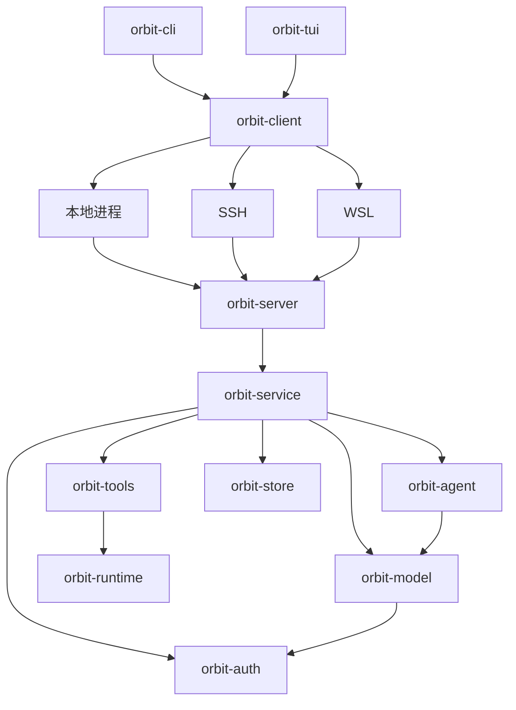

# Orbit

Orbit 是用 Rust 编写的终端编码 Agent。它提供交互式 TUI 和单次命令行任务，支持多供应商模型、文件工具、命令执行、可选沙箱、持久化会话、后台命令与探索、审查、开发子代理。

## 启动

使用 stable Rust 工具链构建，源码构建还需要 `musl-tools`（含 `musl-gcc`）、`binutils` 和同架构 Rust musl target（x86-64：`rustup target add x86_64-unknown-linux-musl`；AArch64：`rustup target add aarch64-unknown-linux-musl`）；依赖版本由 `Cargo.lock` 固定。命令默认使用目标用户的 shell 与真实开发环境；在 `[command]` 中设置 `sandbox = true` 可启用 Linux Bubblewrap 隔离，此时需要 `bwrap`、`prlimit` 和可用的用户命名空间。审批模式独立于沙箱设置。文件工具使用 Unix 文件描述符接口；其他系统尚未提供完整的等价执行后端。

```sh
cargo run --release -p orbit-tui
./target/release/orbit --help
./target/release/orbit
```

普通 `cargo build` 会自动构建并内置同架构的静态远端服务；首次构建会多花一些时间，后续复用独立的构建缓存。每个前端可执行文件内置服务资源，分发、安装或移动时无需伴随服务文件，用户无需安装 musl 工具链、准备额外服务文件或升级服务器 glibc。`scripts/build-bundle.sh` 将两个前端复制到 `target/bundle/`。

在 TUI 内用 `/ssh HOST [PATH]`、`/wsl DISTRO [PATH]` 打开远端标签，本地与多个远端会话可同时运行；`/new` 在当前环境新建会话，`/local` 新建本地标签。界面在本机渲染，Agent 与工具在各自环境运行。也保留实验性的命令行连接入口：

```sh
orbit-cli connect --workspace /path/to/project
orbit-cli connect --ssh my-host --workspace /home/me/project
orbit-cli connect --wsl Ubuntu --workspace /home/me/project
```

`/ssh`、`/wsl` 可打开连接弹窗，提供别名补全、认证提示、连接日志与远端目录选择；指定主机和目录则直接连接。SSH 沿用系统 OpenSSH 配置；SSH/WSL 首次连接自动上传匹配架构的 Linux 服务二进制。远端会话默认沿用本地配置和所引用的认证，无需在目标项目创建 `config.toml`；目标仍需工具执行依赖。本仓库目前仍是 Linux 客户端，WSL 适配器需要调用环境能运行 `wsl.exe`，不代表已支持 Windows 原生构建。断开连接不会取消任务，可用相同参数加 `--resume <ID>` 接回。支持范围、配置路径和恢复行为见 [工作区连接说明](crates/orbit-client/README.md#工作区服务)。

用 TUI 的 `/connect` 配置连接，或参考 [config.example.toml](config.example.toml) 编写 `config.toml`。可用 `--config <路径>` 指定配置文件，API Key 也可通过 `orbit-cli auth set-key` 保存，再用配置中的 `credential` 引用。示例中的模型 ID 和能力需要与实际服务一致。

API 模型的可用列表由服务接口发现；公共模型规格补齐缺失能力，缓存与离线快照保证更新失败后仍可使用。用户配置和服务返回的能力优先，详见 [模型目录说明](crates/orbit-config/README.md#模型目录)。

网页读取、搜索与网络图片自动沿用启动环境中的 `HTTP_PROXY`、`HTTPS_PROXY`、`ALL_PROXY`（也支持小写）和 `NO_PROXY`，通常无需为 Orbit 再配置代理。可选的 `[web].proxy` 用于显式覆盖环境路由；默认仅允许公网目标；`allowed_origins` 可授权指定的内网 HTTP(S) 来源，重定向的每一跳均按策略校验。

```sh
orbit-cli chat "审查当前项目的代码并说明发现的问题"
orbit --resume <SESSION_ID>
orbit-cli sessions list
orbit-cli sessions diagnostics <SESSION_ID>
orbit-cli model-metadata crates/orbit-config/src/models/model_metadata.json
```

TUI 图标需要 Nerd Font 字体。图片按终端能力选择 Kitty、Sixel 或 iTerm2 协议；不支持像素图形时图片使用字符预览，公式保留 TeX。Markdown、HTML、代码、图片和 RaTeX 数学公式的支持范围见 [TUI 文档](crates/orbit-tui/README.md)。

## 工作区结构

| Crate | 职责 | 文档 |
| --- | --- | --- |
| `orbit-cli` | 命令行参数、入口分发、输出与信号 | [README](crates/orbit-cli/README.md) |
| `orbit-tui` | 终端绘制、排版、键鼠交互、标签与弹窗 | [README](crates/orbit-tui/README.md) |
| `orbit-client` | 本地、SSH、WSL 连接、部署和事件订阅 | [README](crates/orbit-client/README.md) |
| `orbit-protocol` | 请求、事件封装、能力与分帧 | [README](crates/orbit-protocol/README.md) |
| `orbit-config` | 共享配置、模型目录与连接编辑 | [README](crates/orbit-config/README.md) |
| `orbit-service` | 会话、工具装配、任务与工作区服务 | [README](crates/orbit-service/README.md) |
| `orbit-server` | 无界面服务可执行入口 | [README](crates/orbit-server/README.md) |
| `orbit-agent` | 模型/工具执行循环、消息边界、后台等待、上下文整理 | [README](crates/orbit-agent/README.md) |
| `orbit-model` | 通用消息类型、供应商协议、模型目录与思考参数适配 | [README](crates/orbit-model/README.md) |
| `orbit-auth` | 凭据存储、OAuth 回调、令牌刷新与服务地址绑定 | [README](crates/orbit-auth/README.md) |
| `orbit-runtime` | 工作区文件访问、执行策略、进程资源与 Linux 隔离 | [README](crates/orbit-runtime/README.md) |
| `orbit-tools` | 文件、命令、网页、文档、交付与 MCP 工具 | [README](crates/orbit-tools/README.md) |
| `orbit-store` | SQLite 会话、规范日志、执行检查点和子任务持久化 | [README](crates/orbit-store/README.md) |

CLI 和 TUI 通过 `orbit-client` 连接目标端的 `orbit-server`，本地、SSH、WSL 使用同一会话协议。应用服务组装领域库，Agent 依赖模型与工具接口，工具通过 runtime 授权和执行，store 保存会话与运行证据。



界面持有布局、选区和显示状态，应用层持有运行资源和执行任务。依赖向领域库流动，领域库独立于前端。`scripts/check-architecture.py` 检查包依赖与前端执行边界。

## 任务与会话

- 后台命令立即返回任务 ID，完成后自动回传结果；Agent 可以继续其他工作，空闲时通过事件等待。命令进程不跨程序重启恢复。
- 子代理提供独立的探索、审查和开发角色；开发角色默认使用 Git worktree，并继承父审批策略，默认并行上限 8，支持补充消息和原会话续跑。默认不限轮数；超时配置用于提醒父代理查看进度，不直接终止子代理。
- `/btw` 在弹窗中独立回答旁路问题，不调用工具、不改变主会话上下文。
- SQLite 保存会话、消息、任务结果与检查点；单写入者锁避免多个窗口同时修改同一会话。数据库、附件和 scratch 位于用户数据目录，具体路径见 [存储文档](crates/orbit-store/README.md)。

权限模式、命令网络策略、受保护文件、外部授权和 MCP 宿主进程的边界见 [工具文档](crates/orbit-tools/README.md) 与 [运行时文档](crates/orbit-runtime/README.md)。

## 开发与验证

```sh
python3 scripts/check-architecture.py
cargo fmt --all --check
cargo clippy --workspace --all-targets -- -D warnings
cargo test --workspace
```

依赖已缓存时可为 Clippy 和测试增加 `--offline`。部分测试启动本地回环 HTTP 服务，需要允许本地监听，不需要真实供应商账号。CI 配置见 [.github/workflows/ci.yml](.github/workflows/ci.yml)。

标记为 ignored 的真实沙箱与工具链测试不会被普通测试命令执行。沙箱测试需要 Linux 用户命名空间；编码循环测试还需要 Python、Node，以及 `ORBIT_TEST_RUST_TOOLCHAIN` 指向可挂载的 Rust 工具链：

```sh
cargo test -p orbit-tools --test sandbox -- --ignored
cargo test -p orbit-tools --test coding_loop -- --ignored
```

代码维护约定：

- 按职责归属共享类型、策略和接口，调用方复用所属模块的实现；局部实现保持私有，不为测试扩大公共 API。
- 常量按领域归类，用 `SCREAMING_SNAKE_CASE` 表达用途，数值名称注明字节、行数等单位，时间使用 `Duration`。参数默认值、Schema 上限与实际校验使用同一来源；数值相同但语义不同的策略保持独立。
- 函数内按解析与校验、资源准备、执行与等待、回执整理等逻辑阶段留空行，避免代码堆叠，也不逐行插入空行。
- 导入按标准库、外部依赖、当前 crate 分组。注释只解释必要的接口约束、协议差异、安全前提和不明显的行为；不复述函数名、字段名或测试步骤。CLI 的帮助注释同时作为用户文案维护。
- 按职责拆分长文件，原入口保留明确的调用接口；较大的测试模块放入对应目录的 `tests.rs`。相似实现先核对语义再复用，保留供应商协议、权限校验和不同分页游标的边界。
- 修改后先运行相关回归，再执行工作区检查，并核对公共接口、回执结构和最终差异。未执行的 ignored 测试不计为已验证。
- 项目文档统一维护在根目录和各 crate 的 README 中；新增或移动模块时同步更新相关 README，并检查本地链接。
